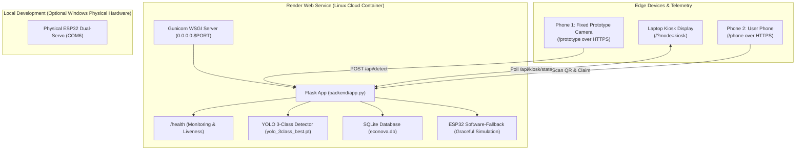

# EcoNova — Render Cloud Deployment Guide

This guide details the complete process to deploy the **EcoNova AI Waste Segregation System** as a **Python Flask Web Service** on [Render](https://render.com) from a GitHub repository.

---

## 1. Architecture Overview in Cloud Deployment



---

## 2. GitHub Preparation

### Step A: Verify `.gitignore`
A `.gitignore` file has been created in the repository root. Ensure the following items are excluded so you do not exceed GitHub's 100 MB file limit:
- `training/` (~394 MB of dataset images and weights)
- `runs/` (local YOLO training checkpoints)
- `New folder/` (temporary archives)
- Base weights `yolo11n.pt` and `yolov8n.pt`
- Dynamic SQLite files: `database/*.db`
- Dynamic QR codes: `rewards/*.png`

> [!IMPORTANT]
> The authoritative trained 3-class model `ai/models/yolo_3class_best.pt` (**5.47 MB**) is strictly tracked and committed to Git. It will be pushed to GitHub and loaded on Render.

### Step B: Push to GitHub
Run the following commands in the project root (`C:\Users\kusha\OneDrive\Desktop\econova`):

```bash
# 1. Initialize git (if not already done)
git init

# 2. Add files respected by .gitignore
git add .

# 3. Commit
git commit -m "feat: prepare EcoNova for Render cloud deployment"

# 4. Set branch to main
git branch -M main

# 5. Link your GitHub remote repository
git remote add origin https://github.com/<your-username>/econova.git

# 6. Push to GitHub
git push -u origin main
```

---

## 3. Render Web Service Configuration

1. Log in to [dashboard.render.com](https://dashboard.render.com).
2. Click **New +** and select **Web Service**.
3. Connect your GitHub repository (`<your-username>/econova`).
4. Configure the settings with the exact parameters below:

| Setting | Value | Notes |
| :--- | :--- | :--- |
| **Name** | `econova` (or unique name e.g. `econova-ai`) | Determines your onrender.com subdomain |
| **Region** | Select region closest to you (e.g. `Singapore` or `Frankfurt`) | Lower network latency for camera frames |
| **Branch** | `main` | Production branch |
| **Root Directory** | *(Leave blank)* | Uses root of repo |
| **Runtime** | `Python 3` | Linux container |
| **Build Command** | `pip install --upgrade pip && pip install -r requirements.txt` | Installs headless opencv, ultralytics, gunicorn, etc. |
| **Start Command** | `gunicorn --workers 1 --threads 4 --bind 0.0.0.0:$PORT backend.app:app` | Single worker keeps RAM under 512MB limit |
| **Instance Type** | `Free` (or `Starter` $7/mo) | Starter recommended if persistent disk is needed |

---

## 4. Environment Variables

In the **Environment Variables** tab of your Render service, configure:

| Key | Example Value | Description |
| :--- | :--- | :--- |
| `PUBLIC_BASE_URL` | `https://econova.onrender.com` | **Required.** Public URL encoded into reward QR codes. |
| `PYTHON_VERSION` | `3.11.9` | Ensures consistent Python 3.11 environment. |
| `DATABASE_PATH` | *(Optional)* `/var/data/econova.db` | Use if mounting a Render Persistent Disk. |

> [!NOTE]
> Render automatically injects `PORT` (e.g. `10000`) and `RENDER_EXTERNAL_URL`. EcoNova automatically checks `PUBLIC_BASE_URL` or `RENDER_EXTERNAL_URL` when generating reward QR codes.

---

## 5. Deployed Application URLs

Once deployment completes (`Live` status), test the following endpoints:

| Endpoint | Path | Role / Description |
| :--- | :--- | :--- |
| **Health Check** | `/health` | Returns `{"status": "ok"}` (Requires no hardware or YOLO inference). |
| **Phone 1 (Prototype Camera)** | `/prototype` | Mounted phone UI. Auto rear camera, ~4 FPS frame streaming to `/api/detect`. |
| **Phone 2 (User Phone)** | `/phone` | User phone UI. Camera strictly OFF, `[ SCAN QR ]`, `[ DASHBOARD ]`. |
| **Laptop Kiosk Screen** | `/?mode=kiosk` | Kiosk chamber display, synchronizes screens 1–5, displays large QR code. |
| **Reward Redemption** | `/reward/<reward_id>` | Claim page opened when Phone 2 scans the kiosk QR code. |
| **Dashboard** | `/dashboard` | SQLite analytics and impact metrics. |

---

## 6. Architecture & Hardware Considerations

### 1. ESP32 Hardware & COM6
- **Local Operation**: On your Windows laptop, running `python backend/app.py` directly interfaces with `COM6` to actuate physical servos G18 and G19.
- **Render Deployment**: Cloud Linux containers do not have physical USB serial connections. EcoNova's `esp32_controller.py` automatically detects this and falls back to **software-only simulation mode** (`[ESP32] Hardware unavailable - running in software-only mode`). Startup and web routes will **never crash** on Render.

### 2. SQLite Database Persistence
- **Render Free Tier**: The filesystem on Render Free instances is **ephemeral**. Any SQLite records saved to `database/econova.db` will reset when the instance restarts or redeploys.
- **Production Persistence**: To persist user points and recycling history across redeployments on Render:
  1. Upgrade to a paid instance (e.g., Starter $7/mo).
  2. Add a **Persistent Disk** mounted at `/var/data`.
  3. Add the environment variable `DATABASE_PATH=/var/data/econova.db`.

### 3. Memory & Single-Worker Gunicorn
- Render's Free tier provides 512 MB RAM.
- Ultralytics YOLO models load PyTorch neural network weights into memory.
- Using `--workers 1 --threads 4` in the Start Command ensures only one model instance is loaded into memory, staying safely within the 512 MB limit while maintaining in-memory kiosk state synchronization.
